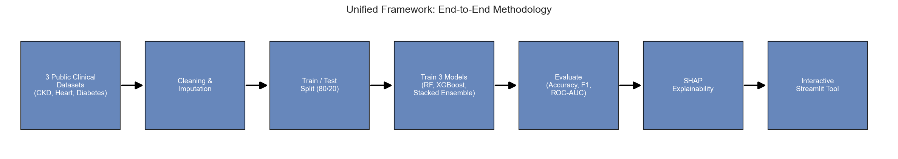
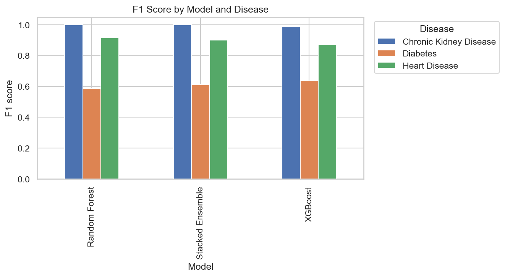
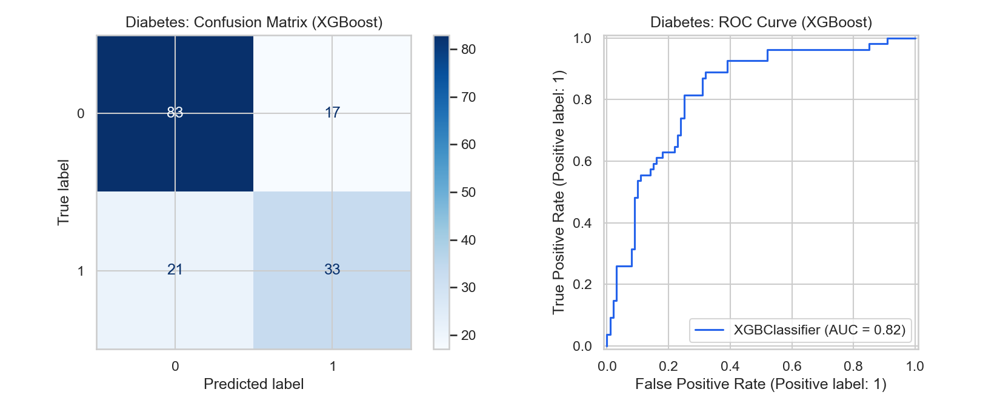
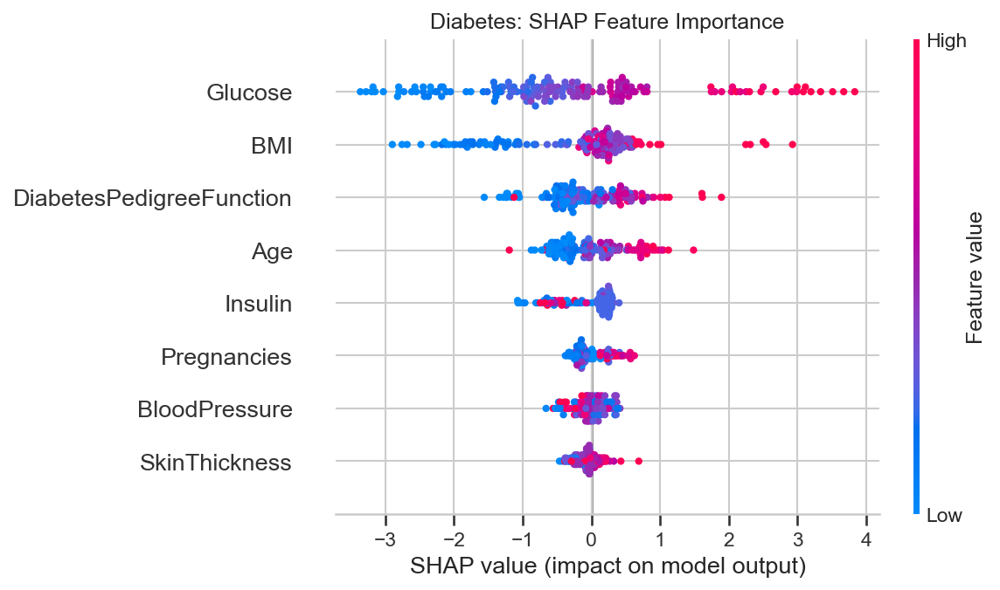

# A Unified Explainable Ensemble Machine Learning Framework for Early Prediction of Multiple Chronic Diseases Using Routine Clinical Biomarkers

The same ensemble pipeline, Random Forest, XGBoost, and a stacked ensemble of both, each explained
with SHAP, is trained separately on three public clinical datasets (Chronic Kidney Disease, Heart
Disease, and Diabetes), then compared across all three to see which clinical indicators carry
predictive weight across different conditions.

## Method



Each dataset goes through the same stages: cleaning and imputation, an 80/20 train-test split,
training all three models, evaluating them on accuracy, precision, recall, F1 and ROC-AUC, then
explaining the best-performing model with SHAP.

## Results



Chronic Kidney Disease is close to perfectly separable on this dataset, a known property of the
benchmark itself. Heart Disease and Diabetes are harder, which is typical for these two datasets in
the wider literature.





SHAP consistently ranks the clinically expected features at the top for each condition: hemoglobin
and serum creatinine for kidney disease, thalassemia and chest pain type for heart disease, glucose
and BMI for diabetes.

## Project layout

- `data/`: the three public datasets (UCI Chronic Kidney Disease, UCI Heart Disease, Pima Indians Diabetes).
- `notebook/`: `Multi_Disease_ML_Framework.ipynb`, the shared training/evaluation code (`common.py`), and the saved trained models.
- `figures/`: every chart, table screenshot, and diagram generated by the notebook, used in the paper.
- `app/`: the Streamlit demonstration tool.
- `paper/`: the research paper and its supporting result tables.

## Running the notebook

```
pip install -r requirements.txt
jupyter notebook notebook/Multi_Disease_ML_Framework.ipynb
```

## Running the app

```
streamlit run app/app.py
```

## Live demo

https://multi-disease-ml-framework.streamlit.app/

---

For research and educational demonstration only. Not a diagnostic device.
